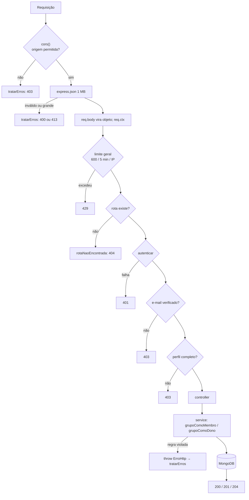
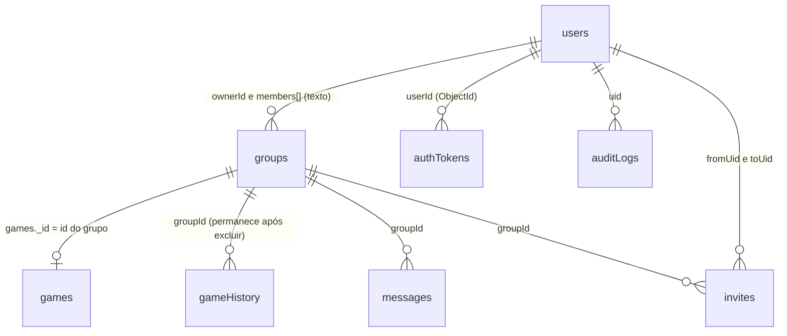

# API, middlewares e banco de dados | Todos os endpoints, a cadeia de uma requisição e cada coleção do MongoDB.

## api | API e cliente-servidor | O contrato entre o navegador e o servidor.

Uma **API** é o conjunto de operações que um programa oferece a outro. A nossa é própria (Node.js + Express) porque as regras precisam rodar em um lugar que o jogador não controla e porque a senha do banco não pode ir para o navegador.

| Método | Uso na API | Exemplo real |
| GET | ler, sem alterar | `GET /api/groups` (exceção: nas listagens de um admin, o grupo DEMO é criado se não existir) |
| POST | criar ou executar uma ação | `POST /api/games/:gid/start` |
| PUT | gravar o recurso inteiro | `PUT /api/rooms/:id` |
| PATCH | alterar só alguns campos | `PATCH /api/users/me` |
| DELETE | remover | `DELETE /api/groups/:id/members/:uid` |

### APIs externas realmente usadas

| Serviço | Quem chama | Para quê |
| Brevo (`api.brevo.com`) | servidor | e-mails de verificação e redefinição |
| Google OAuth 2.0 / OpenID Connect | servidor (e redirecionamento do navegador) | login com Google |
| Firebase Authentication e Firestore REST | servidor | **somente** migração de contas antigas |
| DiceBear 9.x | navegador | imagem do avatar a partir de estilo e semente |
| CDNs (jsDelivr, unpkg, Google Fonts) | navegador | Bootstrap, Chart.js, QRCode.js, Pyodide, Lucide e fontes |

{{codigo|backend/src/services/email.js|async enviar(}}

## endpoints | Todos os endpoints | Prefixo `/api`. "Jogador" = token + e-mail verificado + perfil completo.

| Método e caminho | Quem | Resposta de sucesso |
| `GET /health` | público | `200 {status, banco, agora}` ou 503 |
| `GET /time` | público | `200 {now}` |
| `GET /events` | token + e-mail | fluxo SSE |
| `POST /auth/register` | público, limite | `201` sessão |
| `POST /auth/login` | público, limite | sessão ou próxima etapa |
| `POST /auth/logout` | token | `204` |
| `POST /auth/email/verify` | público, limite | `200` |
| `POST /auth/email/resend` | token, limite | `200` |
| `POST /auth/password/forgot` e `/reset` | público, limite | `200` |
| `POST /auth/2fa/verify` e `/2fa/legacy/verify` | desafio, limite | sessão |
| `POST /auth/2fa/setup`, `/enable`, `/disable`, `/recovery-codes` | token, limite | `200` |
| `POST /auth/2fa/migration/setup` e `/enable` | desafio, limite | `200` |
| `GET /auth/google` | público, limite | `302` |
| `GET /auth/google/callback` | público (**sem** limite) | `302` |
| `POST /auth/google/exchange` | código, limite | sessão |
| `GET /users/me` · `DELETE /users/me` | token | `200` · `204` |
| `PATCH /users/me` | token + e-mail | `200` |
| `GET /users/me/stats` | jogador | `200` |
| `GET /users/username-available/:username` | token + e-mail | `200 {available}` |
| `GET /users/:uid` · `/users/:uid/presence` | token + e-mail | `200` |
| `GET /groups` · `POST /groups` | jogador | `200` · `201` |
| `GET /groups/:id` | membro | `200` |
| `DELETE /groups/:id` | dono | `204` |
| `POST /groups/:id/invite-code` | dono | `200 {inviteCode}` |
| `POST /groups/:id/join` | jogador com código | `200` |
| `DELETE /groups/:id/members/:uid` | dono ou o próprio | `204` |
| `GET` e `POST /groups/:id/invites` | dono | `200` · `201` |
| `GET` e `POST /groups/:id/messages` | membro | `200` · `201` |
| `GET /invites/received` · `/invites/sent` | jogador | `200` |
| `POST /invites/:id/response` | convidado | `204` |
| `DELETE /invites/:id` | convidado ou remetente | `204` |
| `GET /games/:gid` | membro | `200 {game}` |
| `POST /games/:gid` · `DELETE` | dono | `201` · `204` |
| `POST /games/:gid/players` | membro | `204` |
| `POST /games/:gid/start` | dono | `204` |
| `POST /games/:gid/clues/:objeto` | jogador da partida | `204` |
| `POST /games/:gid/puzzles/:chave` | jogador da partida | `204` |
| `POST /games/:gid/end` | membro (expirar) ou dono (desistir) | `204` |
| `GET /rooms/:id` · `PUT` | token + e-mail · admin | `200` |
| `GET /audit` | admin | `200` |

## exemplos | Requisições e respostas reais | Capturadas executando a API com MongoDB em memória.

```requisição
POST /api/groups
Authorization: Bearer <JWT>
Content-Type: application/json

{ "name": "Corvos" }
```

```resposta 201
{ "id": "6b0863375b1883f2fda7346b", "name": "Corvos",
  "ownerId": "6b0863345b1883f2fda73456", "members": ["6b0863345b1883f2fda73456"],
  "memberCount": 1, "maxMembers": 4, "inviteCode": "spg45a5u",
  "demo": false, "createdAt": 1795711799306 }
```

Erros têm sempre o mesmo formato: `codigo` estável para o programa e `mensagem` para a pessoa.

```respostas de erro reais
GET /api/groups sem token        -> 401 {"erro":{"codigo":"TOKEN_AUSENTE","mensagem":"Faça login para continuar."}}
GET /api/groups/:id de estranho  -> 403 {"erro":{"codigo":"NAO_MEMBRO","mensagem":"Você não faz parte deste grupo."}}
GET /api/audit como jogador      -> 403 {"erro":{"codigo":"SOMENTE_ADMIN","mensagem":"Área restrita a administradores."}}
login com {"email":{"$ne":null}} -> 400 {"erro":{"codigo":"DADOS_INVALIDOS","mensagem":"O campo o e-mail é inválido."}}
PATCH /api/users/me {"role":"admin"} -> 400 {"erro":{"codigo":"CAMPOS_NAO_EDITAVEIS", ...}}
21ª chamada de autenticação      -> 429 {"erro":{"codigo":"MUITAS_TENTATIVAS", ...}}
```

## middleware | Middlewares | Funções em fila entre a requisição e a resposta.

Um **middleware** recebe `(req, res, next)`. Ele pode preparar dados, responder e encerrar, ou chamar `next()`. Existe para não repetir a mesma verificação em cada rota. O **controller** é o fim da fila: lê o que precisa de `req`, chama o service e monta a resposta.

{{codigo|backend/src/app.js|export function criarApp}}

A ordem de registro **é** a ordem de execução:



### Inventário completo

| Middleware | Arquivo | Registrado em | Verifica | Falha |
| `cors` | `app.js` | global | `Origin` na lista de `FRONTEND_URL` (sem Origin passa) | 403 `ORIGEM_NAO_PERMITIDA` |
| `express.json` | `app.js` | global | JSON válido até 1 MB | 400 / 413 |
| anônimo (corpo e ctx) | `app.js` | global | corpo é objeto; injeta `req.ctx` | troca por `{}` |
| `limitadores.geral` | `middleware/limites.js` | `/api` | 600 por 5 min por IP | 429 |
| `limitadores.autenticacao` | `middleware/limites.js` | rotas de `/auth` (menos logout e callback) | 20 por 15 min por IP, contador **compartilhado** entre elas | 429 |
| `autenticar` | `middleware/autenticacao.js` | rotas protegidas | `Bearer`, assinatura, validade, usuário existe, `sessionVersion` | 401 |
| `exigirEmailVerificado` | idem | grupos, convites, partidas, sistema, usuários | `emailVerified` | 403 |
| `exigirPerfil` | idem | grupos, convites, partidas, stats | `profileComplete` | 403 |
| `exigirAdmin` | idem | `PUT /rooms/:id`, `GET /audit` | `role === "admin"` | 403 |
| `rotaNaoEncontrada` | `middleware/erros.js` | depois das rotas | nenhuma rota casou | 404 |
| `tratarErros` | idem | último | tipo do erro | status do erro ou 500 genérico |

{{codigo|backend/src/middleware/autenticacao.js|export async function autenticar}}

{{codigo|backend/src/middleware/autenticacao.js|26-41}}

{{codigo|backend/src/middleware/limites.js|1-18}}

{{codigo|backend/src/middleware/erros.js|export function tratarErros}}

> Os handlers são `async` e não têm `try/catch`: no **Express 5**, uma Promise rejeitada é encaminhada sozinha ao middleware de erro.

### Um caminho real, do começo ao fim

`POST /api/games/:gid/start`: cliente → `cors` → `express.json` → ctx → limite geral → `rotasPartidas` → `autenticar` → `exigirEmailVerificado` → `exigirPerfil` → `partidasController.iniciar` → `iniciarPartida` (`grupoComoDono`) → `games.updateOne` → `tempoReal.notificar` → `204`.

{{codigo|backend/src/routes/partidas.js|export function rotasPartidas}}

{{codigo|backend/src/controllers/partidasController.js|export async function iniciar}}

## colecoes | MongoDB: coleções e documentos | Nove coleções, criadas quando o primeiro documento ou índice aparece.

| Coleção | Guarda | Apagada quando |
| `users` | conta, hash, perfil, 2FA, aceite dos termos | conta excluída |
| `authTokens` | hash de tokens temporários | uso ou TTL |
| `groups` | nome, dono, membros, código | grupo excluído |
| `invites` | convites | cancelamento, exclusão de grupo ou conta |
| `messages` | chat | TTL de 24 h ou exclusão do grupo |
| `games` | a partida **atual** de cada grupo | nova partida, cancelamento, grupo excluído |
| `gameHistory` | resumo de cada partida **encerrada** | só quando fica sem jogadores |
| `auditLogs` | quem fez o quê e quando | **nunca pelo código** |
| `rooms` | sala editada pelo admin | — |

A conexão é criada uma única vez e os índices são garantidos na inicialização:

{{codigo|backend/src/config/banco.js|export async function conectar}}

{{codigo|backend/src/config/banco.js|export async function criarIndices}}

### Documento real em `users`

```json
{ "_id": "ObjectId(6b0863345b1883f2fda73456)", "email": "ana@teste.com", "name": "ana",
  "passwordHash": "$2b$12$js5BwRWYaViWF...", "emailVerified": true, "role": "player",
  "profileComplete": true, "twoFactor": { "enabled": false }, "sessionVersion": 0,
  "termsVersion": "1.0", "termsAcceptedAt": "2026-11-26T16:49:56.782Z",
  "username": "ana", "usernameLower": "ana", "avatarStyle": "bottts", "avatarSeed": "abc",
  "createdAt": "2026-11-26T16:49:56.782Z", "updatedAt": "2026-11-26T16:49:57.445Z" }
```

## jogos | `games` × `gameHistory` | A pergunta que mais precisa de resposta segura.

| | `games` | `gameHistory` |
| Papel | estado **vivo** e compartilhado | registro **permanente** e resumido |
| Quantos por grupo | no máximo 1 (`_id` = id do grupo) | um por partida encerrada |
| Criação | `criarPartida` (`insertOne`) | `arquivarPartida` (`upsert` com `$setOnInsert`) |
| Atualização | várias (`$push`, `$set`) | nenhuma; só `$pull` do jogador na exclusão de conta |
| Contém | semente, configuração, pistas e enigmas com autor e hora | totais: enigmas, dicas, tentativas, pontos, duração |
| Exclusão | `DELETE /games/:gid` ou exclusão do grupo | sobrevive a ambas |
| Consultada por | sala do jogo e estatísticas (em andamento) | estatísticas |

**Por que duas?** Para jogar de novo, o documento do grupo precisa ser apagado e recriado. Se o resultado ficasse só nele, o histórico se perderia. O resumo separado também fica pequeno e não carrega a configuração inteira.

### `games` (real, `config` omitida)

```json
{ "_id": "6b0863375b1883f2fda7346b", "groupId": "6b0863375b1883f2fda7346b",
  "ownerId": "6b0863345b1883f2fda73456", "difficulty": "facil", "seed": 111,
  "status": "COMPLETED", "players": ["6b08...3456", "6b08...345d"], "config": { },
  "createdAt": "...16:49:59.546Z", "startedAt": "...16:49:59.575Z",
  "expiresAt": "...17:14:59.575Z", "finishedAt": "...16:49:59.735Z", "score": 824,
  "found":  { "livro": { "by": "6b08...3456", "at": "...16:49:59.640Z" } },
  "solved": { "p1": { "by": "6b08...3456", "at": "...16:49:59.660Z", "hints": 0, "attempts": 0 } } }
```

### `gameHistory` (real, da mesma partida)

```json
{ "_id": "ObjectId(6b0863375b1883f2fda73478)", "groupId": "6b0863375b1883f2fda7346b",
  "players": ["6b08...3456", "6b08...345d"], "difficulty": "facil", "status": "COMPLETED",
  "score": 824, "puzzlesTotal": 3, "puzzlesSolved": 3, "hints": 0, "attempts": 0,
  "createdAt": "...16:49:59.546Z", "startedAt": "...16:49:59.575Z",
  "finishedAt": "...16:49:59.735Z", "durationMs": 160 }
```

{{codigo|backend/src/services/historico.js|1-47}}

### Os três momentos do arquivamento

1. Conclusão (`registrarEnigma` do enigma final).
2. Desistência ou tempo esgotado (`encerrarPartida`).
3. Exclusão do grupo (`apagarGrupo`), antes de remover o documento: cobre a partida vencida que ninguém encerrou.

O índice único `(groupId, createdAt)` torna a operação **idempotente**: arquivar duas vezes não duplica. Partida ainda em andamento, dentro do prazo, não vira histórico quando o grupo é excluído. Partida cancelada no lobby também não.

> ! A atualização em `games` e a gravação em `gameHistory` são **duas operações separadas, sem transação**. Se o processo caísse entre elas, a partida ficaria concluída sem resumo; excluir o grupo arquivaria, mas iniciar uma nova partida apagaria o documento sem arquivar.

## relacoes | Relacionamentos, consultas e isolamento | Como um documento aponta para outro.



São **referências por id**, sem chave estrangeira: a integridade é mantida pelo código (exclusão em cascata em `apagarGrupo` e `excluirConta`).

| Consulta | Índice que a atende |
| `users.findOne({ email })` | `email` único |
| `users.findOne({ usernameLower })` | `usernameLower` único parcial |
| `groups.find({ members: uid })` | `members` (multikey) |
| `messages.find({ groupId, expiresAt > agora }).sort(createdAt).limit(60)` | `(groupId, createdAt)` |
| `invites.find({ toUid, status })` | `(toUid, status)` |
| `games.find({ players, status })` | `(players, status)` — `explain()` mostrou `IXSCAN` |
| `gameHistory.find({ players: uid })` | `(players, finishedAt)` — `explain()` mostrou `IXSCAN` |

**Isolamento** entre grupos e jogadores é feito no servidor: o `uid` sai do token e cada operação de grupo passa por `grupoComoMembro` ou `grupoComoDono`; histórico e estatísticas filtram por `players: uid`. Todos compartilham o mesmo banco e as mesmas coleções.

### Regras aplicadas antes de gravar

- Formato e tipo (`utils/validacao.js`).
- Permissão (dono, membro, jogador, admin).
- Estado (transição de status, prazo, dependências) no filtro da própria escrita.
- Unicidade pelos índices.

O banco **não** tem validação de schema (`$jsonSchema`): quem garante o formato é a aplicação.

{{codigo|backend/src/utils/validacao.js|export function texto(}}
