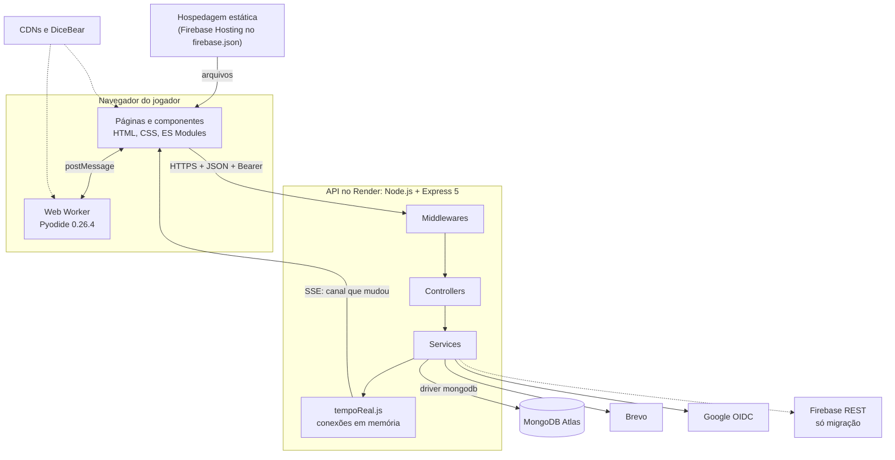
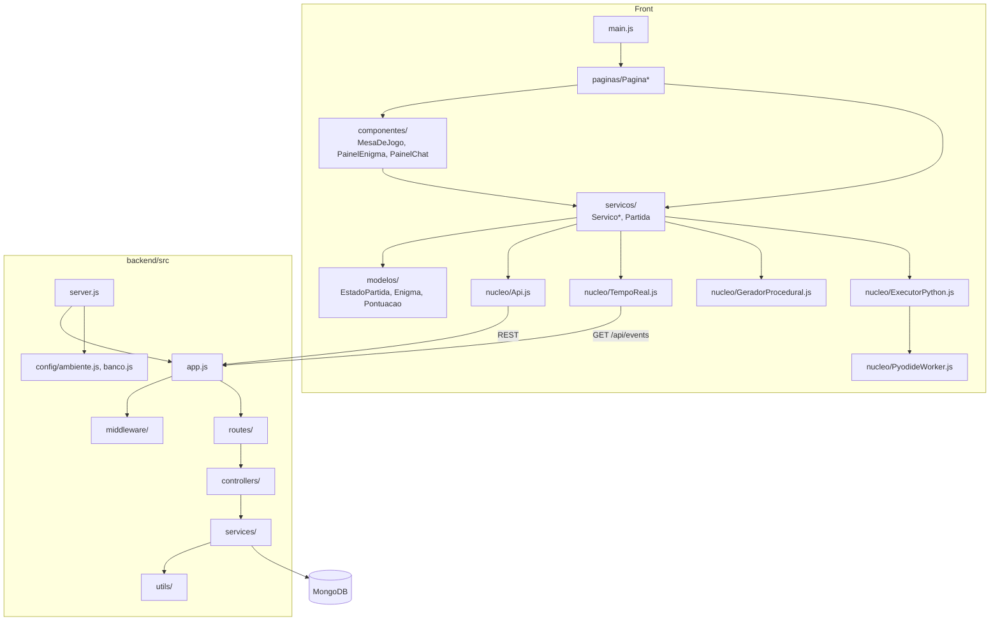
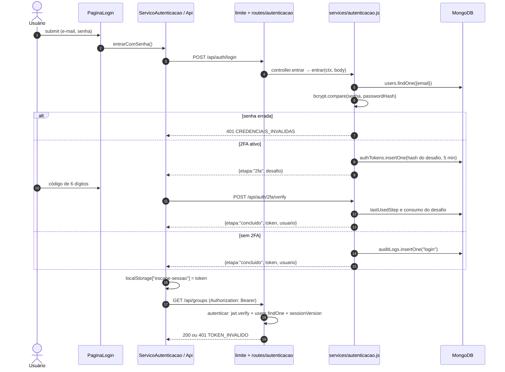
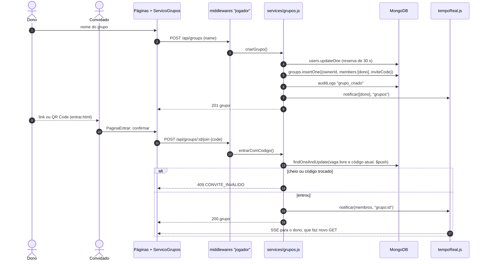
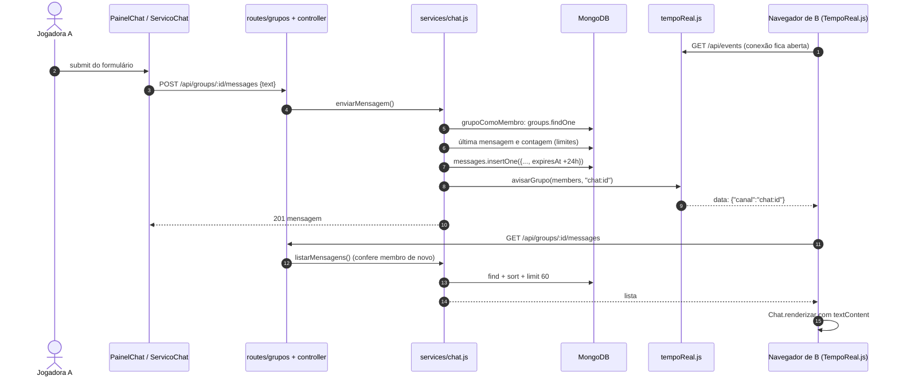
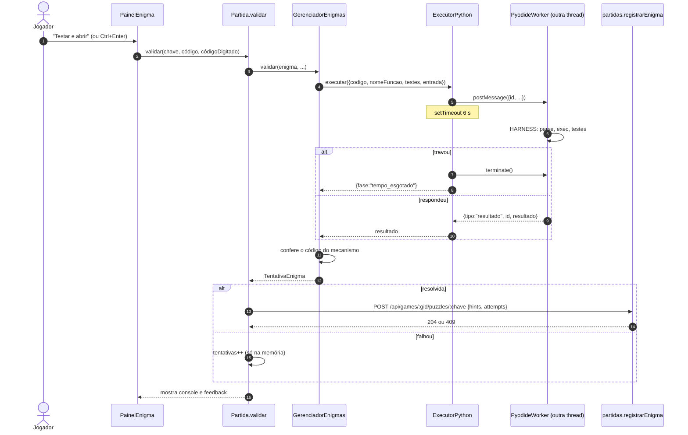
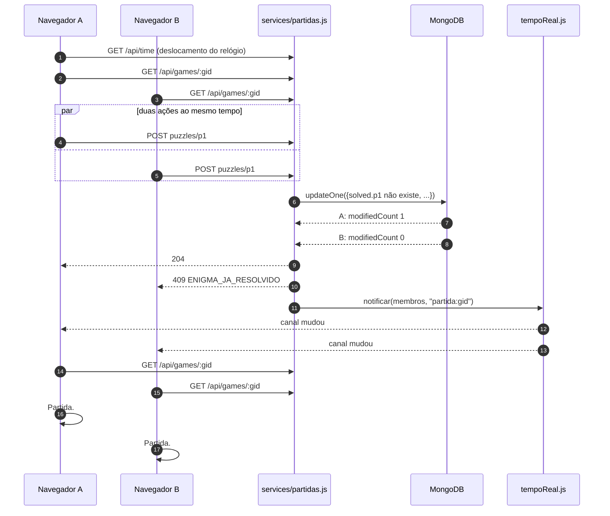
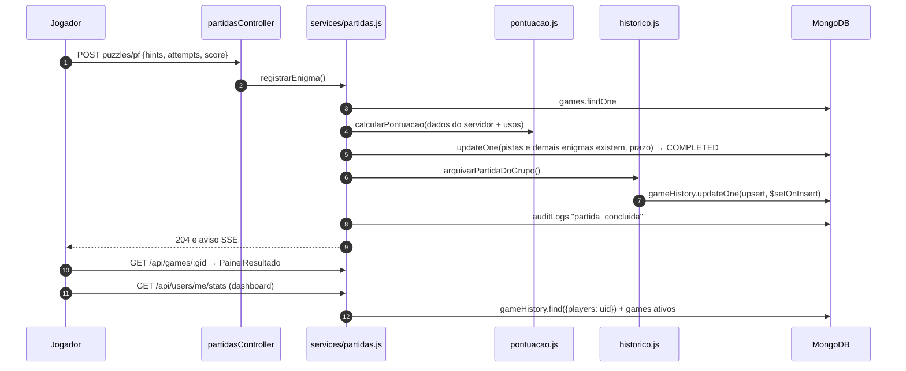
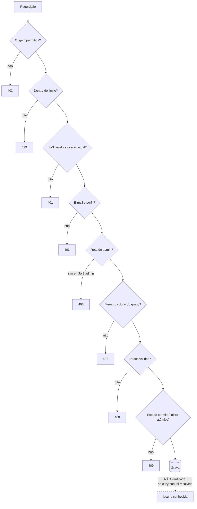

# Diagramas e fluxos reais | Nove diagramas montados a partir do código atual, cada um com a explicação. Use "Ampliar" e role para os lados no celular.

> Os diagramas interativos usam a biblioteca Mermaid, carregada pela internet. Sem conexão, aparece o texto do diagrama. Para a apresentação, abram a página antes ou imprimam em PDF.

## arquitetura | 1. Arquitetura geral | Onde cada parte roda e como conversa.

- **Quem inicia:** o navegador, ao baixar os arquivos estáticos.
- **Participantes:** o front decide a aparência; a API decide permissões e regras; o banco persiste.
- **Dados:** JSON por HTTPS; pelo SSE vai apenas o nome do canal.
- **Resultado:** só a API tem a credencial do banco.

## componentes | 2. Componentes | Quais módulos dependem de quais.

- `server.js` monta o objeto `ctx` (banco, e-mail, Google, tempo real) e o injeta em `criarApp(ctx)`. Os testes trocam essas dependências.
- No front, a direção é página → componente/serviço → núcleo.

## seq-auth | 3. Sequência de autenticação | Login com senha, 2FA e requisição protegida.

- **Início:** o `submit` do formulário. **Entra:** e-mail e senha. **Sai:** JWT assinado com o id e a versão da sessão.
- O token completo só existe depois de todos os fatores.

## seq-grupos | 4. Criação e entrada em grupos | Do botão ao vetor `members`.

- **Quem decide a vaga:** o filtro do `findOneAndUpdate`, não a tela.
- O convite por username segue outro caminho (`invites`), mostrado na galeria abaixo.

## seq-chat | 5. Sequência do chat | Três requisições, um aviso.

- O aviso não leva o texto; quem foi removido do grupo não consegue buscá-lo.

## seq-python | 6. Execução de um desafio Python | Duas threads e um registro no servidor.

- **O código Python nunca vai para a API.** O servidor recebe só a afirmação de que foi resolvido.

## seq-sync | 7. Sincronização do jogo | Um age, todos recarregam.

- O front trata `ENIGMA_JA_RESOLVIDO` como sucesso (`ServicoPartida.registrarResolucao`).

## seq-fim | 8. Finalização e persistência | Do enigma final ao gráfico.

- `score` do corpo é só conferido quanto ao formato; o valor gravado é o calculado no servidor.
- Desistência e expiração seguem `encerrarPartida`, que também arquiva, com `score: null`.

## seguranca | 9. Segurança e autorização | As barreiras, em ordem, e o buraco.

- `CORS` só limita navegadores; um script direto passa dessa primeira barreira e para na autenticação.

## galeria | Diagramas detalhados da equipe | Sequências com nomes de métodos, já alinhadas à versão Express + MongoDB. Toque em "Ampliar".

<h3>Cadastro e verificação de e-mail</h3>
<figure class="diagrama">
<button type="button" class="ampliar">Ampliar</button>

</figure>
<h3>Login, 2FA e logout</h3>
<figure class="diagrama">
<button type="button" class="ampliar">Ampliar</button>

</figure>
<h3>Login com Google</h3>
<figure class="diagrama">
<button type="button" class="ampliar">Ampliar</button>

</figure>
<h3>Perfil</h3>
<figure class="diagrama">
<button type="button" class="ampliar">Ampliar</button>

</figure>
<h3>Grupos: entrar e responder convite</h3>
<figure class="diagrama">
<button type="button" class="ampliar">Ampliar</button>

</figure>
<h3>Grupos: sair, remover, renovar código e excluir</h3>
<figure class="diagrama">
<button type="button" class="ampliar">Ampliar</button>

</figure>
<h3>Chat (tela do grupo)</h3>
<figure class="diagrama">
<button type="button" class="ampliar">Ampliar</button>

</figure>
<h3>Partida: criar, entrar e iniciar</h3>
<figure class="diagrama">
<button type="button" class="ampliar">Ampliar</button>

</figure>

O diagrama de chat usa `PaginaGrupo`; dentro da sala, o mesmo caminho começa em `PainelChat`.

## revisar | O que corrigir nos diagramas do repositório | A pasta `diagramas/` do GitHub ainda descreve a versão antiga.

> ! Não projetem os arquivos abaixo sem atualizar: a banca pode perguntar "onde está esse Firebase no código?".

| Arquivo em `diagramas/` | Problema verificado | Correção |
| `bpmn - autent.png` | raia **Firebase** autenticando | trocar por API própria + MongoDB e incluir verificação de e-mail |
| `bpmn - chat.png` | grava no Firebase e "registra auditoria" no envio | `messages` no MongoDB; **não há** auditoria de mensagem |
| `bpmn - partida.png` | Firebase; mostra o servidor registrando tentativa errada e a aplicação validando o código | validação no navegador; tentativas não vão ao servidor quando falham |
| `bpmn - grupos.png` | omite a entrada por link/QR Code | acrescentar o fluxo `join` |
| `diagrama de classe - parte 3` | `ServicoChat` com `Firestore`, `deSnapshot` e contador em `groups/{gid}/rate` | usar `Api`, `tempoReal`, `Mensagem.deDados`; limite no servidor |
| demais diagramas de classe | não foram conferidos classe a classe neste guia | revisar procurando `Firebase`, `Timestamp` e `Snapshot` |
